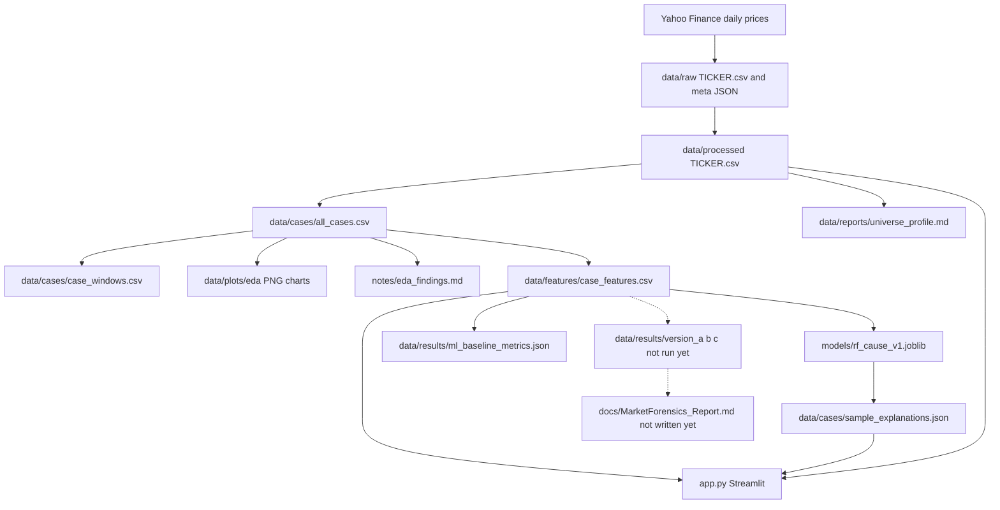
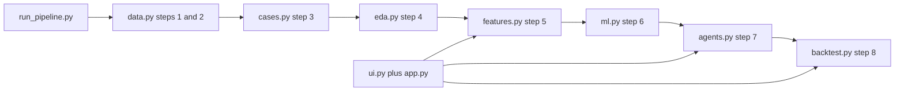

# MarketForensics — full project handoff

**Read this first if you are an AI or a new person continuing this repo.**  
**Root:** `C:\Users\shivangi\Projects\marketforensics`  
**Written:** 7 October 2026  
**Owner machine:** Windows, PowerShell, Python 3.11, about 8 GB RAM  

This file is the map of the whole project: purpose, rules, folders, every important file, column names, numbers already computed, and what is not done. Do not invent prices, labels, headlines, or agent text. If an input file is missing, stop and print the command that creates it.

Educational research. Not financial advice. Not a live trading system.

---

## 1. What the project is

MarketForensics explains unusual **already observed** daily jumps in Indian NSE stocks.

It does **not** tell anyone to buy or sell. It does **not** try to predict tomorrow as the main goal.

Question:

> When an NSE stock has an unusually large daily move, do simple price and volume clues say whether that day looks market-wide, stock-specific, a volume spike, or unclear?

Three chat-model designs (solo, team vote, team debate) are **coded** and **not yet run**. Their result folders are empty. Do not fabricate those outputs.

---

## 2. Status on disk (as of this handoff)

| Piece | Status |
|-------|--------|
| Download 31 NSE stocks + Nifty from 2022-01-01 | Done |
| Clean onto the Nifty calendar | Done. 1,172 rows each, 2022-01-03 to 2026-09-30 |
| 1,322 big-move cases | Done. `data/cases/all_cases.csv` |
| EDA charts, universe profile, five findings | Done |
| Feature table, 1,322 rows, 0 skipped | Done |
| Random forest, time split | Done. Test accuracy **0.9167**. Train through **2025-05-09** (938 rows). Test from **2025-05-12** (384 rows) |
| Groq agents A, B, C | Code only. Not run |
| Mystery score saved on case JSON | Formula in code. Case JSON folder not filled |
| Headlines | Code only. Do not attach today's news to old dates |
| Backtest and final PDF-style report | Code only. `docs/MarketForensics_Report.md` does not exist yet |
| Streamlit app | Done. Shows real cases. Agent and backtest pages stay empty until steps 7 and 8 |
| Midterm write-up | `docs/MarketForensics_Midterm.md` |
| Presentation canvas | `C:\Users\shivangi\.cursor\projects\c-Users-shivangi-Projects-marketforensics\canvases\midterm-presentation.canvas.tsx` |

`TATAMOTORS.NS` failed (Yahoo: quote not found). It is listed in `data/raw/download_failures.json`. Grasim and Hindalco were included instead. Final stock count is 31 plus the index.

---

## 3. How to run

```powershell
cd C:\Users\shivangi\Projects\marketforensics
python -m pip install -r requirements.txt
streamlit run app.py
```

Leave that window open. Browser is usually `http://localhost:8501`. Stop with `Ctrl+C`.

Rebuild data and the model (several minutes, needs internet):

```powershell
python run_pipeline.py --steps 1-6
```

Agents and backtest, only after `GROQ_API_KEY` is set in `.env`:

```powershell
copy .env.example .env
python run_pipeline.py --steps 7 --n 50
python run_pipeline.py --steps 8
```

One case only:

```powershell
python run_pipeline.py --steps 7 --ticker RELIANCE.NS --date 2024-06-04
```

Everything:

```powershell
python run_pipeline.py --all --n 50
```

The runner prints a banner per step, rows in, rows out, and a final file list. A missing input raises `PipelineError` with the command to create it.

---

## 4. Hard rules for any future change

1. No fake prices, no demo answers, no handwritten agent paragraphs presented as model output.
2. If an input is missing, stop. Name the file and the command.
3. Features for a case use only rows on or before the event day.
4. The "after" window (`post_mean_return`) is for humans. Do not feed it to the model.
5. Train on older dates, test on newer dates. Do not shuffle. Do not put the same calendar day in both sets.
6. Do not forward-fill missing prices.
7. Do not attach a headline to a case unless its publish time is within one day of the case date.
8. High model accuracy here means the forest reproduced the label rules. Say that in every write-up.
9. Do not describe the project as a trading system.
10. The canonical runner is `run_pipeline.py`. The `stage00` … `stage08` folders are older lessons. Do not treat them as the source of the 1,322-case results.

---

## 5. Folder tree

```
C:\Users\shivangi\Projects\marketforensics\
├── app.py                          # streamlit entry; calls ui.main()
├── run_pipeline.py                 # steps 1-8
├── requirements.txt
├── README.md
├── .env.example                    # GROQ_API_KEY, GROQ_MODEL
├── .gitignore
├── .streamlit\config.toml          # dark theme
├── PROJECT_TASKS.md                # older intern task list (AAPL era). Historical.
├── LEARNING_PATH.md                # older stage-by-stage course text
├── TWO_MONTH_PLAN.md               # 8-week plan. Goal document.
├── docs\
│   ├── AI_PROJECT_HANDOFF.md       # this file
│   ├── MarketForensics_Midterm.md  # student midterm. Steps 1-6 only.
│   └── README.md                   # placeholder for the final report
├── src\marketforensics\            # real pipeline code
├── scripts\                        # all lesson scripts (stage01–stage08)
├── stage00_python_basics\          # older lesson notes, not the result pipeline
├── stage01_market_data\
├── stage02_big_moves\
├── stage03_classical_ml\
├── stage04_explainability\
├── stage05_nlp_news\
├── stage06_deep_learning\
├── stage07_causal\
├── stage08_agents_product\
├── notes\                          # learning journals + eda_findings.md
├── models\rf_cause_v1.joblib       # trained forest
└── data\
    ├── DATA_README.md
    ├── raw\                        # Yahoo downloads + *_meta.json
    ├── processed\                  # cleaned OHLCV + return_pct
    ├── cases\                      # big moves, windows, top-3 JSON
    ├── features\case_features.csv
    ├── plots\eda\                  # six PNG charts
    ├── reports\universe_profile.md
    ├── news\                       # empty until a real headline matches a date
    ├── agent_cache\                # empty until Groq runs
    └── results\
        ├── ml_baseline_metrics.json
        ├── version_a\              # empty until step 7
        ├── version_b\
        └── version_c\
```

`data/demo\` may still exist from an early UI experiment. **Do not read it. Do not present it.** The live app does not use it.

`data/cases/^NSEI_big_moves.csv` is a leftover from a pass that briefly treated the index as a stock. It is **not** in `all_cases.csv`. Do not add it to the case count.

`data/processed/RELIANCE.NS_returns.csv` is an older lesson output. The pipeline uses `data/processed/RELIANCE.NS.csv`.

---

## 6. The 31 stocks

`ASIANPAINT.NS`, `AXISBANK.NS`, `BAJAJFINSV.NS`, `BAJFINANCE.NS`, `BHARTIARTL.NS`, `COALINDIA.NS`, `GRASIM.NS`, `HCLTECH.NS`, `HDFCBANK.NS`, `HINDALCO.NS`, `HINDUNILVR.NS`, `ICICIBANK.NS`, `INFY.NS`, `ITC.NS`, `JSWSTEEL.NS`, `KOTAKBANK.NS`, `LT.NS`, `M&M.NS`, `MARUTI.NS`, `NESTLEIND.NS`, `NTPC.NS`, `POWERGRID.NS`, `RELIANCE.NS`, `SBIN.NS`, `SUNPHARMA.NS`, `TATASTEEL.NS`, `TCS.NS`, `TECHM.NS`, `TITAN.NS`, `ULTRACEMCO.NS`, `WIPRO.NS`.

Index file: `NSEI.csv`. Yahoo symbol: `^NSEI`.

Failed: `TATAMOTORS.NS`.

Default chart stock: `RELIANCE.NS` (`DEFAULT_TICKER` in `config.py`).

---

## 7. Constants (`src/marketforensics/config.py`)

| Name | Value | Meaning |
|------|-------|---------|
| `START_DATE` | `2022-01-01` | First day requested from Yahoo |
| `NIFTY_INDEX` | `^NSEI` | Yahoo symbol |
| `NIFTY_STEM` | `NSEI` | Filename without `.csv` |
| `K_BIG_MOVE` | `2.5` | Case if \|return\| >= 2.5 × prior volatility |
| `VOL_WINDOW` | `20` | Trading days in the volatility window |
| `CASE_BEFORE` / `CASE_AFTER` | `5` / `5` | Window around a case |
| `UNIVERSE_LIMIT` | `30` | Keep downloading the Nifty-style list until this many stocks succeed |
| `LABEL_MARKET_ABS` | `1.5` | \|Nifty return\| in percentage points |
| `LABEL_STOCK_VS` | `2.0` | \|stock return − Nifty return\| |
| `LABEL_VOLUME_RATIO` | `2.0` | volume / 20-day average volume |
| `GROQ_MODEL_DEFAULT` | `llama-3.1-8b-instant` | Override with `GROQ_MODEL` in `.env` |
| `PipelineError` | exception | Missing input or failed step. Message includes the repair command |

`ticker_stem("^NSEI")` returns `NSEI`. Other tickers stay as `RELIANCE.NS`.

Label order, first match wins: market_wide, then stock_specific, then volume_shock, else unknown.

---

## 8. Pipeline modules (the real code)

`run_pipeline.py` calls these functions:

| Step | Function | File |
|------|----------|------|
| 1 | `run_download()` | `src/marketforensics/data.py` |
| 2 | `run_clean()` | `src/marketforensics/data.py` |
| 3 | `run_cases()` | `src/marketforensics/cases.py` |
| 4 | `run_eda()` | `src/marketforensics/eda.py` |
| 5 | `run_features()` | `src/marketforensics/features.py` |
| 6 | `run_ml()` | `src/marketforensics/ml.py` |
| 7 | `run_step(n, ticker, date)` | `src/marketforensics/agents.py` |
| 8 | `run_backtest()` | `src/marketforensics/backtest.py` |

### `data.py`

- `download_one`: yfinance, `auto_adjust=True`, `threads=False`, 3 retries with sleep 1, 2, 4 seconds. Flattens MultiIndex columns. Index name `Date`. Writes CSV + `*_meta.json`. On failure returns `error` and does not write a stand-in file.
- `run_download`: walks `NIFTY50_TICKERS` until 30 stocks succeed, then downloads `^NSEI` if needed. Writes `data/raw/download_failures.json`.
- `run_clean`: drops duplicate dates and non-positive Close. Inner-aligns to the Nifty calendar by dropping missing dates (no forward fill). Adds `return_pct`. Writes `data/processed/STEM.csv` and `data/DATA_README.md`. Deletes stray `processed/^*.csv`. Raw `^NSEI` and `NSEI` both map to `processed/NSEI.csv`.

### `cases.py`

- Detection: `baseline = return_pct.rolling(20).std().shift(1)`. Threshold = `2.5 * baseline`. A day is a case when `abs(return) >= threshold`.
- Skips the index and any `*_returns.csv`.
- `all_cases.csv` columns: `ticker`, `date`, `return_pct`, `volatility_baseline`, `threshold`.
- Per stock: `data/cases/TICKER_big_moves.csv` (column `Date` instead of `date`, for older lesson scripts).
- `case_windows.csv` columns: `ticker`, `event_date`, `event_return_pct`, `window_start`, `window_end`, `pre_mean_return`, `post_mean_return`.
- `detect_big_moves` and `build_windows` remain so `stage02_big_moves` scripts still import.

### `eda.py`

Matplotlib backend `Agg`. Example chart ticker is `RELIANCE.NS` if that file exists.

Writes:

- `data/plots/eda/RELIANCE.NS_price_volume.png`
- `data/plots/eda/RELIANCE.NS_return_hist.png`
- `data/plots/eda/RELIANCE.NS_vs_nifty_growth100.png`
- `data/plots/eda/big_moves_per_stock.png`
- `data/plots/eda/big_moves_by_month.png`
- `data/plots/eda/return_vs_volume_corr_heatmap.png` — correlation of stock i's daily return with stock j's volume percent-change, up to 12 stocks
- `data/reports/universe_profile.md`
- `notes/eda_findings.md`

Findings already computed:

- 1,322 cases, 31 stocks
- Most cases: `TITAN.NS` (50)
- Busiest month: 2025-01 (47)
- Median absolute case return: 3.67%
- 98% of cases have a larger absolute stock return than Nifty that day
- Largest up day in cleaned files excluding the index: +10.63% `BAJFINANCE.NS`
- Largest down day: −15.45% `NTPC.NS`

### `features.py`

For each case, history is `df.loc[df.index <= event_day]`, and the last row must be the event day. Needs at least 21 rows. Nifty return that day must exist. No fill with zero.

Output `data/features/case_features.csv` columns:

`ticker`, `date`, `return_pct`, `return_5d`, `vol_20`, `volume_vs_avg20`, `ma_20`, `above_ma`, `momentum_5d`, `vs_nifty`, `nifty_return_pct`, `dow`

`momentum_5d` equals `return_5d` (5-day percent price change). `vol_20` is the 20-day return standard deviation **including** the event day. That differs on purpose from the detection baseline, which **excludes** the event day. Step 6 later adds `label`.

### `ml.py`

Feature columns used by the forest (label is the target, not an input):

`return_pct`, `return_5d`, `vol_20`, `volume_vs_avg20`, `above_ma`, `momentum_5d`, `vs_nifty`, `dow`

Model: `RandomForestClassifier(n_estimators=200, random_state=42, class_weight="balanced", n_jobs=1)`.

Split: unique dates, cut at index `int(0.7 * n_dates)`. Train is `date < cut_date`. Test is `date >= cut_date`.

Per-case top 3: replace each feature with the **training** median and measure the drop in predicted-class probability. Strings go to `data/cases/sample_explanations.json` under key `TICKER|YYYY-MM-DD`.

Global permutation importance: `sklearn.inspection.permutation_importance` on the test set, 5 repeats.

Saved metrics (current run):

- accuracy 0.9166666666666666
- n_train 938, n_test 384
- train_last_date 2025-05-09, test_first_date 2025-05-12
- class counts: stock_specific 755, market_wide 351, unknown 190, volume_shock 26
- Test support: market_wide 68, stock_specific 238, unknown 71, volume_shock 7
- Test precision / recall: market_wide 0.82 / 0.72, stock_specific 0.94 / 0.97, unknown 0.90 / 0.93, volume_shock 1.00 / 0.71
- Permutation importance mean: vs_nifty 0.459, return_pct 0.133, vol_20 0.114, volume_vs_avg20 0.085, others about 0
- Tree feature importance (less reliable here): volume_vs_avg20 0.244, vs_nifty 0.236, vol_20 0.178, return_pct 0.151

Honest note stored in the JSON: the label is a rule on the same Nifty, gap, and volume numbers the model sees. High accuracy means the rule was reproduced on later dates. It does not mean a person confirmed the cause.

### `mystery.py`

`explained_and_mystery(return_pct, nifty_return_pct, volume_vs_avg20)`:

- `stock = abs(return)`, `nifty = abs(nifty return)`
- `market_part = min(nifty, stock)`
- `volume_part = min(stock - market_part, max(0, volume_ratio - 1) * 0.5 * stock)`
- `explained_pct = 100 * (market_part + volume_part) / stock`, clipped 0–100
- `mystery = 100 - explained_pct`, clipped 0–100

### `news.py`

Google News RSS. If the case date is more than 3 days from "now", return `[]` without inventing items. If a fetch works, keep items whose `pubDate` is within 1 day of the case. Write `data/news/TICKER_YYYY-MM-DD.json` only for that kept list.

### `agents.py`

Requires `GROQ_API_KEY`. Uses the `groq` package. JSON keys required from the model: `explanation`, `cause` in {market_wide, stock_specific, volume_shock, unknown}, `confidence` 0–100, `direction` in {up, down, unclear}. Invalid JSON is retried. It is not replaced with a handwritten answer.

Cache path: `data/agent_cache/{version}_{persona}_{ticker}_{date}_{promptsha16}.json`.

`run_investigation(ticker, date)` writes:

- `data/cases/json/TICKER_DATE.json`
- `data/results/version_a/TICKER_DATE.json` (solo)
- `data/results/version_b/TICKER_DATE.json` (numbers, news, skeptic, then majority vote; a tie becomes `unknown` / `unclear`)
- `data/results/version_c/TICKER_DATE.json` (round 1, round 2 rebuttals, chair)

`run_step` takes the latest `n` feature rows by date.

### `backtest.py`

Reads version A/B/C JSON. Direction for A is `parsed.direction`, for B is `vote_direction`, for C is `chair.parsed.direction`. `unclear` is excluded.

Forward return: close on the event day to the first trading day on or after event+30 calendar days, and the same for 90 days. Win = sign matches the predicted up/down.

Splits high vs low volatility at the median `vol_20` of scored cases. Wilson 95% interval and a one-sample t-test of forward returns after "up" calls versus 0. Plain-English sentences must say this is not a trading profit.

Writes `data/results/backtest_summary.json`, `data/reports/backtest_summary.md`, `data/plots/backtest_abc_winrate.png`, and `docs/MarketForensics_Report.md`.

### `charts.py` and `ui.py`

Plotly figures and the Streamlit pages: Home, Pick a case, Case view, Agents, Debate view, Backtest, About. Footer text: "Educational research. Not financial advice."

Home counts files. It does not invent counts. Case view uses processed prices and `NSEI.csv`. Agents button calls `run_investigation`. Debate and Backtest show a command if their JSON is missing.

### Other Python files

| File | Role |
|------|------|
| `download.py` | `download_ticker()` delegates to `data.download_one` |
| `io.py` | `prices_csv`, `load_prices`, close/volume column helpers. Raw path uses `ticker_stem` |
| `llm.py` | Old helper. Refuses to answer if `GROQ_API_KEY` is empty |
| `returns.py` | Older daily-return writer for lesson scripts (`*_returns.csv`) |
| `build_cases.py` | Older JSON assembler. Prefer `agents.case_record` |
| `paths.py` | Inserts `src` on `sys.path` for old scripts |
| `ui_data.py`, `demo_factory.py` | Early demo loader. **Do not use** |
| `__init__.py` | Package version 0.1.0 |

---

## 9. Lesson scripts (not the result pipeline)

| Path | Scripts |
|------|---------|
| `scripts/` | All lesson scripts, named `stageNN_NN_name.py` so they sort by stage |
| `scripts/stage01_01_download_prices.py` … `stage01_08_compute_returns_universe.py` | Market data |
| `scripts/stage02_01_detect_big_moves.py` … `stage02_04_eda_charts.py` | Big moves |
| `scripts/stage03_01_build_features.py` … `stage03_03_train_random_forest.py` | Classical ML |
| `scripts/stage04_01_feature_importance.py`, `stage04_02_top3_reasons.py` | Explainability |
| `scripts/stage05_01_fetch_headlines.py`, `stage05_02_match_headlines_to_cases.py` | News |
| `scripts/stage06_01_mlp_sequence.py` | Deep learning (optional, not part of the reported results) |
| `scripts/stage07_01_mystery_score.py`, `stage07_02_backtest.py` | Causal / backtest |
| `scripts/stage08_01_test_groq.py` … `stage08_04_version_c_debate.py` | Agents |

Each stage folder also has a `README.md`. `notes/stage00.md` … `notes/stage08.md` and `notes/eda_findings.md` are journals. Only `eda_findings.md` matches the pipeline numbers.

---

## 10. Packages (`requirements.txt`)

numpy, pandas, matplotlib, yfinance, python-dateutil, python-dotenv, requests, joblib, scikit-learn, streamlit, plotly, scipy, groq.

No PyTorch in the main pipeline. No SHAP in the main pipeline (local median-replacement is used instead).

---

## 11. Maps

### Pipeline



### Where each step's code sits



### Result files already written

```
Yahoo
  -> data/raw/TICKER.csv + TICKER_meta.json
  -> data/processed/TICKER.csv          (OHLCV + return_pct, Nifty calendar)
  -> data/cases/all_cases.csv           (1,322 rows)
  -> data/cases/TICKER_big_moves.csv
  -> data/cases/case_windows.csv
  -> data/plots/eda/*.png
  -> data/reports/universe_profile.md
  -> notes/eda_findings.md
  -> data/features/case_features.csv    (+ label after step 6)
  -> models/rf_cause_v1.joblib
  -> data/results/ml_baseline_metrics.json
  -> data/cases/sample_explanations.json
  -> (not yet) data/cases/json/*.json
  -> (not yet) data/agent_cache/*.json
  -> (not yet) data/results/version_a|b|c/*.json
  -> (not yet) data/reports/backtest_summary.md
  -> (not yet) docs/MarketForensics_Report.md
```

### Chart files to open

| Picture | Path |
|---------|------|
| Reliance price and volume | `data/plots/eda/RELIANCE.NS_price_volume.png` |
| Reliance return histogram | `data/plots/eda/RELIANCE.NS_return_hist.png` |
| Reliance vs Nifty, growth of 100 | `data/plots/eda/RELIANCE.NS_vs_nifty_growth100.png` |
| Cases per stock | `data/plots/eda/big_moves_per_stock.png` |
| Cases by month | `data/plots/eda/big_moves_by_month.png` |
| Return vs volume-change heatmap | `data/plots/eda/return_vs_volume_corr_heatmap.png` |
| Older single close chart | `data/plots/RELIANCE.NS_close.png` |

---

## 12. Column cheat sheet

**Raw and processed price CSV**

`Date`, `Open`, `High`, `Low`, `Close`, `Volume`. Processed also has `return_pct`.

**all_cases.csv**

`ticker`, `date`, `return_pct`, `volatility_baseline`, `threshold`.

**case_features.csv**

Identity and clues listed in section 8, plus `label` after step 6.

**sample_explanations.json**

Object. Key `RELIANCE.NS|2024-06-04`. Value: list of three strings.

**ml_baseline_metrics.json**

`accuracy`, `n_train`, `n_test`, `train_last_date`, `test_first_date`, `class_counts`, `label_thresholds`, `confusion_matrix_labels`, `confusion_matrix`, `classification_report`, `feature_importance`, `permutation_importance_mean`, `honest_notes`.

---

## 13. App pages and the files they need

| Page | Needs |
|------|--------|
| Home | Any of the data files. Counts may be zero; then it shows `python run_pipeline.py --steps 1-6` |
| Pick a case | `data/features/case_features.csv` |
| Case view | That CSV, `sample_explanations.json`, `data/processed/TICKER.csv`, `data/processed/NSEI.csv` |
| Agents | Same case row. Button calls Groq and writes version_a/b/c |
| Debate | `data/results/version_c/TICKER_DATE.json` |
| Backtest | `data/results/backtest_summary.json` |
| About | Optional `docs/MarketForensics_Report.md` |

---

## 14. Glossary

| Term | Meaning here |
|------|----------------|
| NSE | National Stock Exchange of India |
| Ticker | Yahoo code, `.NS` suffix for NSE stocks |
| Nifty / `^NSEI` | Market benchmark. File `NSEI.csv` |
| OHLCV | Open, high, low, close, volume |
| auto_adjust | Yahoo adjustment for splits and dividends |
| Return | Percent change from prior close to this close |
| Volatility | Standard deviation of daily returns |
| Case | One stock-day that passed the 2.5× rule |
| Clue / feature | A number computed with data only through the event day |
| Label | Rule bucket, not a confirmed news cause |
| Train / test | Older days / later days |
| Leakage | Using the future to explain the past |
| Random forest | Many decision trees voting. scikit-learn |
| Permutation importance | Accuracy drop when one clue is scrambled |
| Groq | Cloud chat API. Not used in the saved midterm numbers |
| Agent A / B / C | Solo / vote / debate. Not run |
| Mystery score | 100 minus a capped share explained by Nifty and extra volume |
| EDA | Charts and summaries before the model |
| Streamlit | The local website |

---

## 15. What a future AI should do next

1. Read this file and `docs/MarketForensics_Midterm.md`.
2. Do not rebuild steps 1–6 unless the user asks. The CSVs and the joblib file are already valid.
3. To finish the project, ask the user for a Groq key in `.env`, then run steps 7 and 8.
4. Keep the honest accuracy sentence in every report.
5. Do not revive `demo_factory.py` or `data/demo`.
6. Do not cite `data/cases/^NSEI_big_moves.csv` as part of the 1,322 cases.
7. Presentation aid already exists at the canvas path in section 2.

---

## 16. Related docs already in the repo

| File | Use it for |
|------|------------|
| `README.md` | Short run instructions |
| `docs/MarketForensics_Midterm.md` | Student-facing midterm |
| `TWO_MONTH_PLAN.md` | Original 8-week teaching plan |
| `LEARNING_PATH.md` | Stage 00–08 lesson goals |
| `PROJECT_TASKS.md` | Older checklist. It still mentions AAPL. The live project is NSE |
| `data/DATA_README.md` | Per-file row counts after cleaning |
| `notes/eda_findings.md` | The five computed insights |
| `data/reports/universe_profile.md` | Per-stock average return and volatility |
